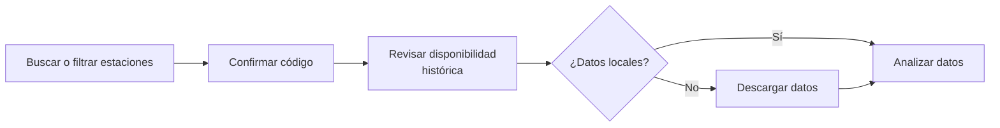

# Uso MCP Server

El servidor MCP permite usar Garúa desde clientes compatibles con [Model Context Protocol]. Es ideal cuando quieres pedir tareas en lenguaje natural y dejar que el cliente de IA llame las tools correctas. Si quieres una explicación visual del flujo, revisa [Qué es MCP en Garúa](mcp-concept.md){data-preview}.

[Model Context Protocol]: https://modelcontextprotocol.io/docs/getting-started/intro

## Ejecutar servidor

```bash
garua-mcp
```

## Configuración básica

```json
{
  "mcpServers": {
    "garua": {
      "command": "garua-mcp"
    }
  }
}
```

Si el cliente no encuentra el comando, usa la ruta absoluta al ejecutable o al Python del entorno virtual. Puedes revisar [Instalar y Configurar](../installation.md#instalar-garua-desde-pypi){data-preview}


!!! info "Nota sobre descargas"
    Cuando pidas descargar datos, Garúa abrirá un navegador local para scrapear el sitio de SENAMHI y superar la verificación Cloudflare Turnstile cuando aparezca. Esto es esperado en la tool de descarga.


## Prompts útiles

```text
- Busca estaciones meteorológicas en Arequipa sobre 3000 msnm
- Qué estaciones hay cerca de lat -7.61, lon -77.82?
- Descarga datos de julio 2025 de la estación Cabana
- Resume julio 2025 para la estación 108047
- Compara marzo 2025 vs marzo 2026 para Cabana
- Valida la calidad de datos de julio 2025 para la estación 108047
```

## Prompts MCP y Resources

El servidor también expone dos workflows como Prompts MCP:

- `analizar_periodo_estacion`: prepara y resume un periodo de una estación.
- `comparar_periodos_estacion`: prepara y compara dos o más periodos.
- `auditar_calidad_datos`: diagnostica anomalías y problemas de calidad.
- `seleccionar_estacion`: ordena candidatos según ubicación, tipo y disponibilidad.

Los clientes que soportan la lista de Prompts pueden renderizarlos con parámetros
como estación, periodo y objetivo. El Prompt guía la secuencia, pero las métricas
siempre las calculan las tools de Garúa.

También están disponibles estos Resources de referencia:

- `garua://catalog/stations`: catálogo local de estaciones SENAMHI.
- `garua://catalog/stations/{station_code}`: ficha detallada de una estación.
- `garua://schema/{station_type}/{status}`: columnas, unidades y convenciones del
  CSV. Por ejemplo, `garua://schema/M/AUTOMATICA`.
- `garua://data/downloads`: índice actualizado de archivos CSV locales.
- `garua://data/files/{station_code}/{filename}`: contenido de un CSV validado
  dentro de la carpeta local de Garúa.
- `garua://about`: versión, configuración y capacidades del servidor.

Los Resources contienen contexto de consulta. Las descargas, transformaciones y
análisis siguen realizándose mediante tools.

## Flujo



!!! example ""
    El **análisis** puede ser un resumen, una comparación entre periodos o una validación de calidad, según tu objetivo.


## Referencia técnica

### Estados del catálogo y disponibilidad

Las fichas, búsquedas, consultas de disponibilidad y recomendaciones exponen
`catalog_status`, `availability_status`, `catalog_checked_at`,
`availability_checked_at` y `note`. La exportación CSV incluye esos campos.

- `listed`: figura en el listado SENAMHI de la fecha indicada.
- `absent`: no figura en ese listado; no confirma una baja oficial y puede
  conservar periodos históricos. Se mantiene disponible para búsquedas.
- `unknown`: no se ha evaluado su presencia en un listado.
- `periods_announced`: la ficha anuncia meses; no confirma observaciones ni
  continuidad hasta la fecha actual.
- `no_periods_announced`: no se encontraron meses en un selector válido; no
  demuestra ausencia total de datos.
- `periods_unknown`: se desconoce el listado de meses anunciados en la ficha,
  porque aún no se consultó o no pudo determinarse. No evalúa la autenticidad,
  exactitud ni calidad del contenido descargado de SENAMHI. Tampoco significa
  que la estación carezca de datos.

El asistente debe explicar estas limitaciones cuando afecten a la selección o
descarga, considerando las fechas de revisión. Los estados no bloquean consultas
explícitas ni eliminan estaciones del catálogo. La puntuación de recomendación
se conserva y debe interpretarse junto con estas advertencias.

El catálogo actualizado con el listado del 27 de octubre de 2026 conserva las
1.010 estaciones previas y añade 19, para un total de 1.029. Incluye 53 ausentes
del listado y tres incorporaciones cuya disponibilidad no pudo verificarse.

La lista completa de tools está en [Referencia de tools MCP](../reference/tools.md){data-preview}. Esa referencia se genera desde los docstrings del código para mantenerla sincronizada con el servidor.

